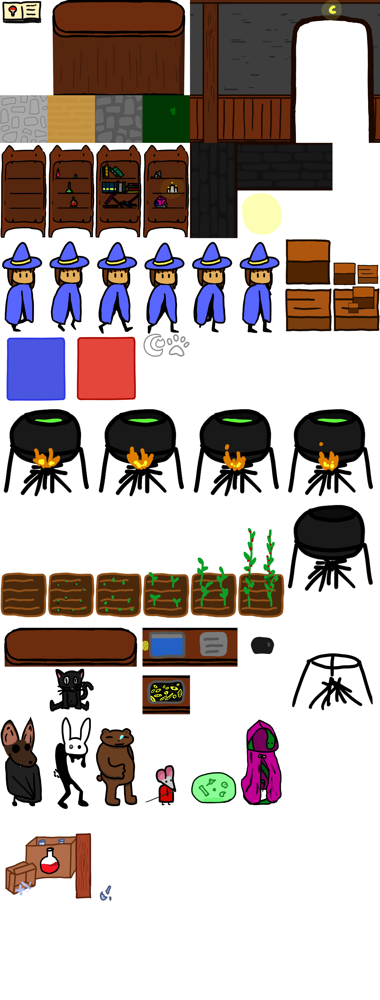
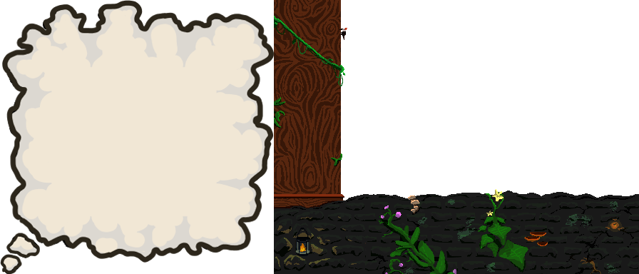

+++
title = "The Journey of Over Scoping"
date = 2026-11-13
page_template = "blog.html"
description = "How a ram-shamble team almost pulled it off, but wasn't even close."
draft = true

[taxonomies]
tags = ["bevy", "Game Jam"]
categories = ["Game Dev"]

[extra]
show_toc = false
+++

# My First Game Jam

As I have begun my game development journey I have emersed myself within the culture of the media surrounding games and making games. Not like I wasn't whole heartedly subscribed to videogames to begin with as I sure have played my fair share, moreso, I have begun to peak behind the curtain. Found out what drives the game culture from behind the scenes. One such thing I have recently discovered, is game jams. I have heard of hackathons and the like from university where all the plucky comp-sci students would amble around like Monster<sup>TM</sup> infused zombies trying to finish... something. Never quite got the appeal. Then by happenstance I found out that Bevy does game jams for every even version release. Last year I played some of the games for bevy's 0.18 relase jam. Now boy howdy was I impressed, these games came out in the span of 9 days and most of them where in a playable, and enjoyable, state. 

This was in the beginning days of my foray into game development. I had just really decided to tap into my atrocious creative side and start thinking outside the box of what shall I watch tonight. I may have said before, I have always fantasized about creating things. Many, many, oh so many abandoned projects to my name. Physical projects that never got beyond a wistful ideation in the shower, creative works that never see the light of day. Hidden behind my imagination, mostly because I can't render anything so save the world itself. Now, spending most of my working day on a computer one would think that I wanted to find a different outlet. But they would be wrong, see, as game development is an interesting mix of technical, artistic, and creative problemsolving that just really gets my engine going. Sure it is mostly behind a keyboard but the skills learned transfer to oh so many other things. Music, art, creativity abound are useful is oh so many ways.

Though I digress, since playing those games from Bevy Jam 7 when I first had discoved Bevy; at a convienient time no less as I only started wanting to get into games at the time. I then figured a game jam might be interesting. The anouncement came almost unexpectedly though. By happenstance I checked on the Bevy discord while walking the dogs and found out the jam had been anounced a few days earlier! See, I had forgotten about the jam held every even version deal. Now I have only been dedicatedly making games for upwards of a year and am by no means good. So unlike the savants that frequent the bevy discord, I needed a team. I am a systems engineer by trade, and thus work with a bunch of other quite quirky and nerdy folks who, if I asked, would work on a game jam in a moments notice. Life is better with friends afterall and luckily for me they had plenty of time for this 9 day walk through purgatory (subtle foreshadowing). Or they had none at all, but still did it anyways cause friends are cool and they all deserve a big golden star for everything they do. So all this to say, I found a team in a matter of days, a handful of individuals ready to make a game.

Our team was interesting, a comp-sci graduate who had won a game jam in high school, but never programed in rust before. A physics graduate who has a baby on the way any moment yet really wanted to do art when I asked them super last minute to join. A fellow chemical engieer who has never really coded in their life but makes dope ass sounds and music. And another engineer, who has dabbled in game making before but never in rust and had to find the time in-between writting for NaNoWriMo (which I found out this month is people try writing whole ass books in a month). So with our last minute team put together, we eagarly awaited the theme anouncement. The discord was all aflutter with what the theme could be, as voting was visible and transparent to the whole community. I had my bets on synthetic enviornment (had some good ideas for it to), until again, on a walk with the dogs I found out it was Alchemy. Now there are endless possibilities of games that one could make with alchemy as a theme. Anything from witchy wonders of grim delight, to futuristic synthesoids running amok in new york city creating dasterdly mixtures of potent poisons. And this is where our biggest hurdle would present itself.

# But what shall we make?

My partner as I was chatting with them about the up coming jam suggested we do an overcooked style game, but with potions and potentially angry customers. I was immediately hooked on the idea. So two days after the theme announcement, our team meets and starts discussing scope. As that is what every good dev team does when the wanna make a game right. Talk about what the hell we're supposed to make and what it should look like. I pitched my partners overcooked idea, and everyone seemed hooked as well. So over an hour or so we discussed the ins and outs of what this had to look like. We talked art, we talked mechanics, we talked about the meaning of life and 42 other things for what this game should be and ultimately came up with this.

># Name TBD Scope
>
>Run an alchemy potion shop and craft potions for you customers. You are playing as a young witch/wizard who is looking after the shop for you old wizened grandpa while they are at wizardcon. Customers will enter the shop and pseudo-randomly give an order for a potion to be brewed.
>
>Art Style:
>- Meme art style 2010's (Thick lines, sparse detail, cute and unhinged)
>- Top down 2D view
>- Map with multiple layers in Z direction
>
>Game Mechanics TODO:
>- [] Each customer presents a desired potion using iconography
>- [] Each potion is made in a cauldron
>- [] Each potion is made up of up to 4 ingredients
>- [] Each potion will require one main base ingredient
>- [] Conflicting effects in a cauldron will explode the cauldron
>- [] Over brewing a potion catches the cauldron on fire
>- [] burnt down and exploded cauldrons must be repaired
>- [] Any extra ingriendients will be modifiers that alter primary ingriedients affects
>- [] A recepie book will show primary effects and secondary effects of each item
>- [] An herb garden to grow herbs used in potions
>- [] A day night cycle, players need to brew potions for customers at night
>- [] Grow herbs during the day and take a nap to end the day and start the next night
>- [] Herbs will be ready for harvest the next night
>- [] Player need to not burn down the shop for 8 moons to win
>- [] Can exchange herbs by using cat workers to go out and find new ingredients for ones they already have 

Now this doesn't seem so bad right? Yeah we thought so, we thought we were all hot shit for sure. This game is small! There are only like 15 rules to make the mechanics, and those can be boiled down to like a handful of similar systems that feed off each other. This is where that foreshadowing comes to mind. This game is indeed not small, between the mechanics, and the artists discovering how hard it is to make art in 9 days while also never having made a sprite sheet before, the scope is relatively massive. This <small>smol</small> scope further evolved when the artists made a litle list of what they all had to do.

>Art TODO:
>- [] Ingredient Book & Book UI
>- [] Ingredient Sprites
>- [] Customer Demand Sprites
>- [] Customers
>- [] Potion Shop
>- [] Cauldron
>- [] Drying Racks
>- [] Mortar & Pestle
>- [] Flasks
>- [] Grow Beds
>- [] Plant Sprites

The artists tried their best, and honestly, it was well put together. The art fit the theme of the game masterfully. Where the sprite sheets hard to naivgate programmatically? Oh yes, yes they where. But lessons learned, sprite sheets need a standard established on the onset. Artists and programmers need a crisp clean line of communication on what the program needs, and what the artists can render out. Now I wouldn't say I neglected to talk to the art team and discuss what the art should be and what a sprite sheet should look like. But I was indeed very wishy-washy on what the sprite sheet layout should be. Which ultimately led us to this, the art, gorgeous. Making it work in game, a nightmare.



Am I right though? The art is stellar, the pictures are exactly what we where looking for. But then we ran into issues on making the sprite sheet itself. One artists did the sheet up above. But then another did this wonderous artwork below. We wanted to use this as a border around the shop that the player runs. Alas, since one artist exported pulled in the sprite sheet into our map editor as an image, we couldn't fit in the border art into the map as we hastily tried to submit the game last minute. But it deserves to be scene so here it is! 



But then myself and the other programmer needed to make it work in game. And this then lead to just a bunch of pixel hunting. As each sprite is of a different size as one can see. Nothing is really square, and the sprite sheet is a mix of animation columns and rows and static assets. So, to make all this work we had to build a sprite sheet utility to work with it all! 

Our methodology, was to just hard code in where in the sprite sheet an asset was, and work from there specifying the columns and rows for each type of animation. [The Bevy Flock](https://github.com/TheBevyFlock/bevy_new_2d.git) group has a really well done 2D template that goes into detail on how to set up sprite animation like this. We based our game off of this template. Though I think at the time we started the jam it wasn't updated to bevy 0.20.

So what we ended up doing, was constructing sprites as a scene when entering the gameplay state of the game. The state where the witch Celeste is in the shop and can move around. The player character, Celeste, uses the same idea. As would the customers if we ever got around to putting them in the game.

```rust
/// Construct the station using its own loaded assets and behavior scene.
/// `shop.rs` positions the returned scene root at a Tiled point marker.
pub fn stations(kind: StationKind, assets: &StationAssets) -> impl Scene {
    let sheet = assets.sheet(kind);
    let layout = assets.layout(kind);
    let transform = Transform::from_scale(Vec3::splat(kind.spec().scale));

    bsn! {
        @stations_base_scene(kind)
        Sprite {
            image: sheet,
            texture_atlas: {
                Some(TextureAtlasTemplate {
                    layout: layout.into(),
                    index: 0
                })
            }
        }
        transform
    }
}

/// Cached texture handles and atlas layouts for station scenes.
#[derive(Resource, Asset, Clone, Reflect)]
#[reflect(Resource)]
pub struct StationAssets {
    /// One handle per station kind, in `StationKind::ALL` order. Currently all
    /// kinds share the same source sheet but use different atlas regions.
    #[dependency]
    sheets: Vec<Handle<Image>>,
    /// One atlas layout per kind, in the same order. Built in code
    /// with `Assets::add`, not loaded so no #[dependency]
    layouts: Vec<Handle<TextureAtlasLayout>>,
    /// For debug and primitives construction
    pub debug_mesh: Vec<Handle<Mesh>>,
    pub debug_material: Vec<Handle<ColorMaterial>>,
}

impl StationAssets {
    pub fn sheet(&self, kind: StationKind) -> Handle<Image> {
        self.sheets[kind.index()].clone()
    }

    pub fn layout(&self, kind: StationKind) -> Handle<TextureAtlasLayout> {
        self.layouts[kind.index()].clone()
    }

    pub fn mesh(&self, kind: StationKind) -> Handle<Mesh> {
        self.debug_mesh[kind.index()].clone()
    }

    pub fn material(&self, kind: StationKind) -> Handle<ColorMaterial> {
        self.debug_material[kind.index()].clone()
    }
}

impl FromWorld for StationAssets {
    fn from_world(world: &mut World) -> Self {
        // The lists below are looked up by `kind as usize`, so `ALL` must match
        // the enums's order. this catches a mismatch in dev builds.
        for (i, kind) in StationKind::ALL.iter().enumerate() {
            debug_assert_eq!(
                kind.index(),
                i,
                "StationKind::ALL must list variants in declaration order."
            );
        }

        // A texture atlas is a fancy way to split a single image into a grid of related images.
        // an example is found here: https://github.com/bevyengine/bevy/blob/latest/examples/2d/texture_atlas.rs
        let layouts = {
            let mut layouts = world.resource_mut::<Assets<TextureAtlasLayout>>();
            StationKind::ALL
                .iter()
                .map(|kind| {
                    let sheet = kind.sprite_sheet();
                    layouts.add(TextureAtlasLayout::from_grid(
                        sheet.frame_size,
                        sheet.columns,
                        sheet.rows,
                        Some(UVec2::splat(sheet.padding)),
                        Some(sheet.offset),
                    ))
                })
                .collect()
        };

        let debug_mesh = {
            let mut meshes = world.resource_mut::<Assets<Mesh>>();
            StationKind::ALL
                .iter()
                .map(|kind| meshes.add(Circle::new(kind.spec().size.x as f32)))
                .collect()
        };

        let debug_material = {
            let mut materials = world.resource_mut::<Assets<ColorMaterial>>();
            StationKind::ALL
                .iter()
                .map(|kind| {
                    materials.add(ColorMaterial {
                        color: kind.spec().color,
                        alpha_mode: AlphaMode2d::Blend,
                        ..default()
                    })
                })
                .collect()
        };

        let assets = world.resource::<AssetServer>();

        let sheet = assets
            .load_builder()
            .with_settings(|settings: &mut ImageLoaderSettings| {
                settings.sampler = ImageSampler::nearest();
            })
            .load("images/SpriteSheet.png");

        let sheets: Vec<Handle<Image>> = StationKind::ALL.iter().map(|_| sheet.clone()).collect();

        Self {
            sheets,
            layouts,
            debug_mesh,
            debug_material,
        }
    }
}

fn sync_atlas_size(
    station_assets: Option<Res<StationAssets>>,
    images: Res<Assets<Image>>,
    mut layouts: ResMut<Assets<TextureAtlasLayout>>,
) {
    let Some(station_assets) = station_assets else {
        return;
    };

    for kind in StationKind::ALL {
        let Some(image) = images.get(&station_assets.sheets[kind.index()]) else {
            continue;
        };

        let Some(mut layout) = layouts.get_mut(&station_assets.layouts[kind.index()]) else {
            continue;
        };

        // read the png dimensions
        let image_size = image.size();
        if layout.size != image_size {
            layout.size = image_size;
        }
    }
}
```

So those functions up above are just helpers that pull in the sprite sheet asset from the game world. And then do some magic in reading pixels and sheet layout to then return an animation. Ideally, we would have had separate animation states that pulled from else where in the sheet as well, but again, time and scope are dastartly enemies.

As you can see, we also have some cute little customer designs. The other programmer and I ended up spending so much time trying to sort out spawning characters and making the game interactable, we didn't end up making anything to interact with. Although, the other programmer Justin did come in with a last minute save to make the plant bed interactable. So we ended up with a cute little witch and her can who you can make walk around the shop and pick up plants.

# So, what did we learn?

Well, I learned how to have a good time under stress. Staying up till 2 am trying to fix merge conflicts cause I forgot how to work git that late. Chatting with the programmers and the artists I worked with and laughing at the ram shamble that we put together. Nine days may seem like a lot, but it really is no time at all.

One thing I found really helpful throughout was teaching rust as well as learning it myself. The other programmer that I worked with for this jam is a code genious. Able to read and understand lines of code like it is the air that they breath. But they had never worked in rust before, and I have even though I have a lot left to learn. So, to be able to teach a new language to this gifted individual gave me a new frame of reference for understanding code.

I like the expression that the best way to understand something, is to try and teach it. So being able to talk code with technical savant who understands, but dosen't quite know the intracacies that is rust, is a great way to learn by teaching I think. Talking with the artists after the jam they mentioned how much they learned as well. By learning sitting down and making time to use the tools that they have been meaning to practice. The jam was the perfect excuse to make time for learning and development. Looking back at the rules too it seems our little team took this jam to heart and embodied learning, even if we didn't finish our little game.
